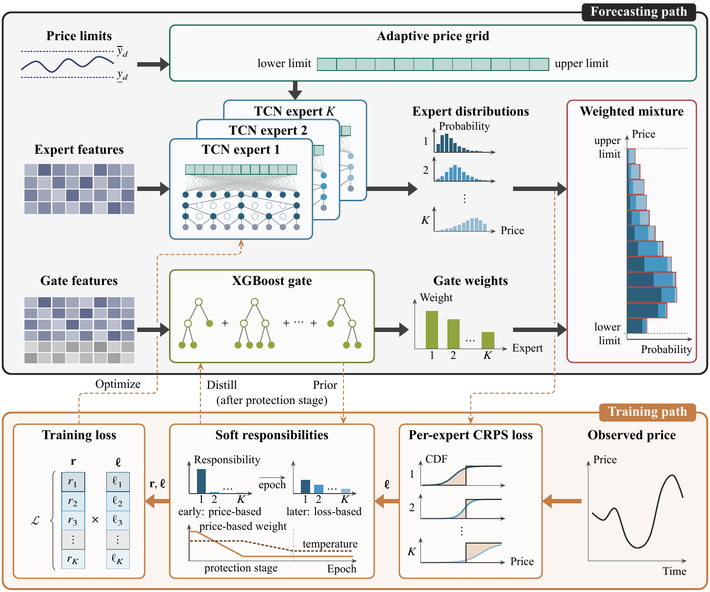

# FLD-MoE

论文 *A forecast-loss-driven mixture-of-experts model with probability-mass output for probabilistic day-ahead electricity price forecasting* 的官方实现。

<p align="center">
  
</p>

## 方法概述

- **多专家概率预测**：多个 TCN 专家基于同一组日前市场边界条件，各自输出一个价格概率分布；XGBoost 门控根据样本特征给出专家权重，加权混合得到最终预测分布。
- **概率质量输出**：专家和混合结果都是限价区间内等距价格网格上的概率质量，不预设分布族，也不需要分位数后处理。
- **预测损失驱动的训练**：专家和门控交替训练。每个专家的 CRPS 与门控先验结合成软责任，用来引导专家分工；门控再拟合这些事后责任，学到事前可用的权重。

## 仓库结构

```text
configs/shaanxi.toml     陕西数据集的模型与训练参数
data/                    陕西数据及说明
src/fld_moe/
  features.py            专家与门控的输入特征
  data.py                数据读取、切分与因果归一化
  model.py               TCN 专家
  gate.py                XGBoost 门控
  distribution.py        价格网格与分布混合
  loss.py                CRPS 与软责任损失
  training.py            交替训练与早停
  evaluation.py          评价指标
  cli.py                 命令行入口
```

## 数据

`data/shaanxi.csv` 为陕西电力现货市场 2025-01-01 至 2026-04-30 的数据，15 分钟分辨率（每天 96 点），包括日前电价（元/MWh）、8 项负荷与出力预测、4 个节点的气象预报。列说明见 [data/README.md](data/README.md)。

| 切分 | 日期                     | 天数 |
| ---- | ------------------------ | ---: |
| 训练 | 2025-01-29 至 2026-02-14 |  382 |
| 验证 | 2026-02-15 至 2026-03-16 |   30 |
| 测试 | 2026-03-17 至 2026-04-30 |   45 |

训练集之前的 28 天仅用于构造历史特征。

## 快速开始

环境要求：Python 3.12+，[uv](https://docs.astral.sh/uv/)。

```bash
git clone <repo-url> && cd FLD-MoE
uv sync --locked
```

检查数据和特征（不训练）：

```bash
uv run fld-moe check-data
```

训练并在测试集上评估：

```bash
uv run fld-moe train --device cuda --output results/shaanxi
```

`--device` 可选 `auto`（默认）、`cpu`、`cuda`；不指定 `--output` 时结果写入 `results/train-<时间>/`。训练结束后会加载验证集上最优的模型，输出验证集和测试集的预测与指标。

根据已保存的预测分布重新计算指标：

```bash
uv run fld-moe evaluate --forecast results/shaanxi/test_distribution.npz
```

## 输出

主要文件：

- `metrics.json`：验证集与测试集指标（CRPS、twCRPS、MAE、RMSE、R²、PICP80、MPIW80、IS80）
- `test_predictions.csv`：真实价格、中位数、10%/90% 分位数
- `test_distribution.npz`：每个时刻的完整预测分布
- `experts.pt`、`gate.ubj`：专家与门控权重
- `history.json`：逐轮训练记录

## 许可证

代码采用 [MIT License](LICENSE)。数据的使用范围见 [data/README.md](data/README.md)。
